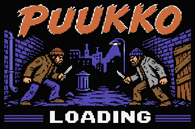

# PUUKKO – A Very Finnish Fight (Commodore 64 edition)


Game to a real Commodore 64, written in C (cc65) with
a small assembly core. PETSCII graphics, layered hardware-sprite fighters,
SID music/effects and **4-bit digitized curse voices** played from the
original `./audio/*.wav` files.

> **Content warning** (travels with the port): deliberately crude, violent,
> alcohol-soaked Finnish working-class parody with constant swearing.

click here for gameplay video

[](https://www.youtube.com/watch?v=fzj04VX8qnc "gameplay")

## Running

On linux if vice is installed.
~~~ sh
x64 release/puukko.d64
~~~

altgr and W while it loads

## Build & run

Requirements: `cc65` (2.18+), `python3` with `numpy`, VICE (`x64sc`, `c1541`).

```
make            # -> build/puukko.d64 (+ build/puukko.prg, build/loader.prg)
make run        # boots the disk in x64sc
```

Load on a real C64 / emulator: `LOAD"*",8` then `RUN`. The first file,
`PUUKKO`, is the loading screen: it shows the PETSCII picture from
`loadscreen/` while it loads `PUUKKO GAME` with the KERNAL (the blue bars
beside LOADING fill up as a progress bar), then starts the game. On a stock
1541 this takes about two minutes, like in the old days; JiffyDOS or a
fastload cartridge helps. `build/puukko.prg` alone also runs without the
loading screen.
PAL is the target (50 Hz game speed); NTSC works, digis are retimed.

Replacing the voices: drop new WAVs over `./audio/<name>.wav` (any rate,
8/16-bit, mono/stereo) and `make` again. They are resampled to 6 kHz,
trimmed, normalised and packed to 4 bits by `tools/mkdata.py`. Keep the total
short: all eleven clips together currently use ~13 KB of the 64 KB machine.

## Controls

| Joystick (port 2 = P1, port 1 = P2) | Action |
|---|---|
| Left / Right | walk (drunkenly) |
| Down | crouch |
| Up | block |
| Fire | stab with the puukko |
| Fire + Down (or fire while crouching) | bottle swing |
| Fire + Up (or fire while blocking) | medkit (dirty rag) |

Keyboard alternatives — P1: `A D W S`, `Z` stab, `X` bottle, `SPACE` medkit.
P2: `J L I K`, `N` stab, `M` bottle, `RETURN` medkit.
`P`/`RUN STOP` pause, `T` back to title (paused/victory), `C` character
select (victory), `O` options (title), `Q`/`←` back in menus.
In 1-player mode a joystick in either port controls P1. For two players
use two joysticks (the C64 keyboard and port 1 share wires, so keyboard +
port-1 joystick at once can produce ghost keys).

Leave the title screen alone for ~20 s and two CPU drunks fight it out
(attract mode); any key returns.

## What was ported

Everything gameplay-related from `js/`: six characters with their stats,
four stages, 99 s timer, bleeding with drips and persistent blood pools,
weak block, crouch damage reduction, trade rule, knockback/hitstun, input
lag, sway & stumbles, rag pickups, medkits, KO / time-up / draw-rematch,
the drunk AI with its three difficulties, hard-core mode, victory screen
with typewriter taunts, title, mode/difficulty/character/stage selects,
VS screen, pause and options.

Differences, mostly forced by the hardware:
- Runs at 50 Hz with the browser's 60 Hz frame counts, so the fight is ~17 %
  slower (even more drunk); the round timer is real seconds.
- Character damage modifiers are applied (the JS computed but never used them).
- Joystick fire+down/up combos work from crouch/block (in the JS the crouch
  check swallowed them).
- Fighters are 3 overlaid hardware sprites each (skin, shirt, multicolour
  pants/hair/black details) — 6 colours per fighter instead of ~10, two
  animation frames dropped (second medkit kneel, fourth victory dance pose).
- Options are not saved to disk.

## How it works

- `src/sys.s` – raster IRQ (frame tick, `$D021` background bands per stage,
  music + SFX player), NMI digi player (CIA2 timer A, 6 kHz, nibbles to
  `$D418`; during speech all three voices are held at a test-bit DC level so
  it is loud on the 6581 and audible on the 8580), keyboard/joystick scan,
  sprite commit/mirroring, xorshift RNG.
- `src/spr.c` – fighters composed at runtime from the JS string-art parts,
  split into sprite layers and cached (one cache sits in RAM under the I/O
  area, the other under the KERNAL; the VIC shows right-facing frames
  straight from the cache, left-facing ones are mirrored into buffers).
- `src/fight.c` – fighter state machines, AI, blood, HUD, pickups, KO,
  victory. The two fighters live in two global structs that are swapped
  (cc65 compiles fixed-address struct access far tighter than arrays).
- `src/stages.c`, `src/gfx.c` – PETSCII stages, text, block letters. The ROM
  charset is copied to RAM only to add `Ä Ö Å`.
- `src/loader.s` – loading screen + loader (picture from
  `loadscreen/*_screen.seq` / `*_color.seq`, progress bar from the KERNAL load
  pointer `$AE/$AF`, resident in the cassette buffer while the game loads).
- `tools/mkdata.py` – WAV → digis, JS tracks → SID event streams, JS synth
  SFX → per-frame voice-3 tables.

Memory map is documented in `puukko.cfg` (BASIC and KERNAL are banked out;
the program uses practically all 64 KB).

### Debug tooling (VICE remote monitor)

`make clean; make DEFS=-DPROF` builds with cycle profiling markers and a test
input hook. `tools/prof.py` prints per-section cycle costs, `tools/perf.py`
the frame rate, `tools/attract.py` starts a CPU-vs-CPU fight immediately,
`tools/drive.py` taps joystick/keys and takes screenshots.
